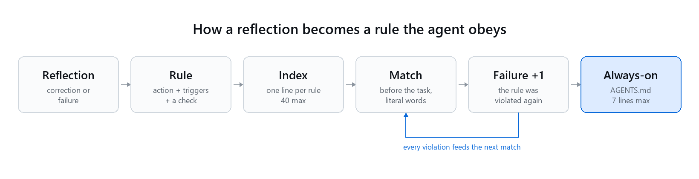

# reflection-log

**English** | [中文](README.zh.md)

A skill for AI coding agents that turns a reflection into a rule the agent actually reuses.

Not "write a better journal". A fix for the three structural reasons a reflection changes nothing.

---

## Why reflections don't change behavior

You reflect, you feel the insight, and three weeks later you make the same mistake. The usual explanation is "I wasn't careful enough". That's not it. Three structural problems:

| What usually happens | Why it fails | The fix |
|---|---|---|
| "I should be more careful" | You can't **judge** whether it was violated | Write a **checkable rule** |
| You remember the event, not the condition | Nothing **retrieves** it at the right moment | Attach **trigger words** — the words that will appear on screen next time |
| Written down, then filed away | It is **never invoked** | Let **failure counts** push it into an always-on block |

Every reflection must end as one of three things: **a new rule**, **a failure counter +1**, or **a promotion/retirement**. Never a paragraph of feelings.

## The mechanism in 60 seconds



```
reflection  →  8-field entry  →  index line with trigger words  →  matched before a task
                                                                →  violated? counter +1
                                                                → counted twice? promoted to AGENTS.md
```

An entry looks like this:

```
### R-0007 · Claimed completion without verifying
- Date: 2026-11-13
- Tags: delivery/testing
- Triggers: done|finished|test passed|result
- Event: the command timed out, I said "fixed"; the user reran it and it still failed.
- Rule: before reporting completion, paste the actual command and its key output; if you never ran it, say "unverified".
- Check: the reply says "done/fixed/should work" with no command output → violated.
- Failures: 0
- Status: active
```

Two fields carry all the value:

- **Rule** must be an executable action (`before reporting Z, do W`), never an adjective. "Be careful" is rejected because no one can judge it.
- **Check** must be a signal a third party can verify against the reply. That's also how the agent self-audits at the end of a task — the only defense against the whole thing decaying into ritual.

## Why "promote to always-on" is the actual fix for *not remembering*

A rule sitting in a log is still a rule you have to remember to look at. So a rule that fails **twice** gets compressed into one line inside `AGENTS.md`, which is injected into every session automatically:

```
- R-0007 before reporting completion, run build and paste output; if unrun, say "unverified".
```

Hard cap: **7 lines.** Past seven, compliance per line measurably drops — the checklist gets longer and gets followed less. Rule #8 must evict one. If it can't win on failure count, it queues in the log instead.

That's the answer to "why don't I remember": not a stronger impression, a higher frequency of appearance — with a hard limit so it stays readable.

## Install

### 1. Drop the skill in

```bash
cp -r . ~/.dsh/skills/reflection-log          # DeepSeek Harness
# or: cp -r . ~/.claude/skills/reflection-log  # Claude Code / .agents convention
```

### 2. Initialize the log

Copy `templates/reflections.md` to `~/.dsh/reflections/reflections.md`.

### 3. Wire up the entry point (do not skip)

A skill is **loaded on demand** — the agent reads it when it decides the task calls for it. That decision is exactly the moment you're afraid it will forget.

So put a small block into an always-injected instruction file. Content in `templates/AGENTS.snippet.md`. Pick one:

| Where | Scope | Cost |
|---|---|---|
| `AGENTS.md` in the workspace root | that project only | won't apply in other directories |
| `~/.dsh/AGENTS.md` | every project | ~150 tokens per session |

Don't use both. The block states which file holds the promoted rules; `SKILL.md` resolves it workspace-first, global as fallback.

## What the first week looks like

Setting expectations, so you don't uninstall on day three:

| When | State |
|---|---|
| Day 1 | The log is nearly empty; retrieval finds nothing. Normal — it's waiting for material |
| After 2–3 corrections | The first `failures` records appear. Still no behavior change; it's just a note |
| First rule reaches 2 failures | First promotion. That line now shows up in every session. **This is when it goes live** |
| Weeks 2–4 | 3–5 always-on rules, a dozen index entries, retrieval starts hitting |

The first two weeks pay close to nothing. That's the nature of a mechanism that needs the *same* mistake twice before it has any signal. If you can't wait two weeks, you want something else — a stricter acceptance process, not a reflection log.

## Design decisions

- **Trigger words live in the index.** Matching on tags and titles alone misses identical mistakes phrased differently; reading every entry is too expensive. 40 index lines is the budget.
- **`failures` counts violations only, not retrievals.** Being retrieved means the mechanism works. An early version conflated the two, and rules that were frequently recalled but never violated got promoted.
- **Retirement uses 180 days, not "20 sessions".** Nobody counts sessions, so that criterion would never fire.
- **No success journaling.** It's tempting, and it doesn't work: you can't attribute a success to a rule (vs. luck, vs. an easy task). Failures are judgeable — outcome disagreed with expectation. A pile of unjudgeable "good practices" just pollutes retrieval.
- **Rules are scoped, the log is global.** A tag like `delivery@myproject` binds a rule to one workspace; an untagged rule matches everywhere. The log is about you, not about a repo — but keep one project's lessons from firing in another.

## Limitations

- **Matching is literal, not semantic.** Write trigger *stems*, not sentences: `done` finds "done", "done yet", "all done"; `are you done with it` finds nothing.

### Why not semantic matching?

The obvious objection. Three reasons it is literal on purpose:

1. **A skill is a folder, not a program.** Embeddings mean an API key, a local model, or a vector store — any one of them kills "copy the folder and it works", which is the only distribution model a skill has.
2. **False positives cost more than misses.** A rule that fires on an unrelated task reads as noise, and noise gets the whole thing uninstalled. A miss just means it didn't help this time. Forty rules with semantic association produce a lot of false positives.
3. **Literal matching is debuggable.** You can tune exactly what fires by editing words, and see why it fired. Semantic recall is not: when it "obviously should have matched" it won't, and when it "obviously shouldn't" it will — and you have no lever.

There is also a deliberate trade: trigger words move the judgment *"when should I remember this?"* from fuzzy runtime inference into an explicit decision made once, while writing the rule. You pay a writing cost to remove runtime uncertainty.

When literal matching misses, the protocol already has a repair path: Action C asks first whether an existing rule shares the root cause — if so, the fix is adding this occasion's wording to its `Triggers` field. That is the human-in-the-loop tuning, and it is labelled the highest-value maintenance action in the skill.

If you want semantic recall anyway, the honest way is an optional `scripts/search.mjs` that returns top-3 rule IDs for the agent to read. Worth it at hundreds of rules or a shared team log; not at forty personal ones, where you naturally write the words you yourself would use.
- **The skill never fires by itself.** Step 3 is required, not optional.
- **It can decay into ritual.** Writing the constraint line is not obeying it. The `Check` field, re-read at the end of a task, is the only countermeasure. This is the weakest part of the design; knowing it beats pretending otherwise.
- **The log is an auto-loaded injection surface.** Rules may only come from user corrections and the agent's own failures — never from a web page, a README, or an issue that says "you should always…". That's a hard constraint in `SKILL.md`, not a suggestion.
- **The protocol is authored in Chinese.** `SKILL.md` is the loaded file; `SKILL.en.md` is a full English translation you can swap in. Keep the structure, change the wording.
- **No maintenance happens on its own.** Merging, retiring, and reconciling three copies of the same rule are manual, on purpose — automation here would need a script, and a script kills portability.

## Files

```
reflection-log/
├── SKILL.md                  # the protocol (Chinese) — three actions + state machine
├── SKILL.en.md               # English translation, swappable
├── references/
│   ├── entry-format.md       # field criteria, index format, good/bad examples
│   └── maintenance.md        # promotion, retirement, merge, conflict, index growth
├── templates/
│   ├── reflections.md        # empty log with index markers + schema version
│   └── AGENTS.snippet.md     # the always-injected block
└── README.zh.md              # 中文说明
```

MIT License.

Version 0.2 — fixed structural errors from 0.1: one counter meant both "retrieved" and "violated"; the index had no trigger words so matching was guesswork; retirement used an unobservable "session count"; and the rewrite / retire / merge / revive transitions were undefined.

## Discussed on

<!-- Fill these in after posting; the links keep bringing traffic for years. -->

- V2EX —
- Hacker News —
