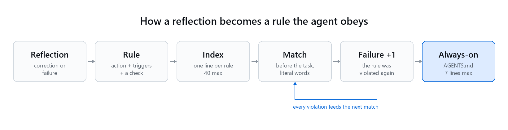

# reflection-log

[English](README.md) | **中文**

给 AI agent 用的一个 **skill**：把每次反思固化成"可判定的规则 + 触发词"，在后续同类情境里被检索、被自查，同一规则重复失效时自动晋升为常驻规则。

针对的是"反思过、印象不深、下次照犯"——不是让你写更多心得，而是改掉反思的结构。

---

## 先说清楚：这不是"训练"

Skill 不是训练模型，也不是微调。它是一个**目录约定**：一个文件夹里放一份 `SKILL.md`，用 YAML frontmatter 写清名字和"什么时候该用"，正文写清"用的时候按什么流程做"。Agent 在合适的时候把它读进上下文，然后照着做。

所以 skill 只能做两件事：**规定流程**、**指向数据**。它不能让模型自动记住任何东西——记忆必须落在文件上。这个仓库把两者都给齐。

## 它解决的问题

| 常见做法 | 为什么没用 |
|---|---|
| 每天写复盘日记 | 写完就忘，下次触发不到 |
| 写"我要更仔细" | 无法判定是否被违反，等于没写 |
| 记在聊天记录里 | 换会话就没了，检索不到 |

三条对策：

1. **规则必须可判定** —— "报告完成前先跑 build 并贴输出"，而不是"要更仔细"。外加一条**校验**：出现什么信号就算违规。
2. **规则必须带触发词** —— 写"下次屏幕上会出现的字"，检索靠字面匹配，不靠联想。
3. **失效次数驱动晋升** —— 同一条规则第 2 次失效，压成一行写进 `AGENTS.md` 常驻块，之后每个会话开头都能看到。这才是"印象不深刻"的解法：不是加深印象，是提高出现频率，同时限制在 7 条以内。



## 安装

### 1. 放 skill

```powershell
Copy-Item -Recurse . "$env:USERPROFILE\.dsh\skills\reflection-log"
```

```bash
cp -r . ~/.dsh/skills/reflection-log
```

### 2. 建日志

把 `templates/reflections.md` 复制到 `~/.dsh/reflections/reflections.md`。

### 3. 挂常驻入口（关键，别跳）

Skill 是**按需加载**的：agent 判断"该用了"才会读它。而"该用了"这个判断，恰好出现在你最希望它别忘的那一刻。

所以要在常驻指令文件里放一个入口块，内容见 `templates/AGENTS.snippet.md`。二选一：

| 放哪 | 生效范围 | 代价 |
|---|---|---|
| 工作区根目录的 `AGENTS.md` | 只这个项目 | 换个目录聊天就不管用 |
| `~/.dsh/AGENTS.md` | 所有项目 | 每个会话多约 150 tokens |

不要两边都放。块里会写明晋升的常驻规则该写在哪一份，`SKILL.md` 的「文件位置」按"工作区优先、全局兜底"的顺序找它。

没有这一步，这套东西只在你想起来的时候有效——那就还是原来的问题。

## 使用

日常你什么都不用做。三种情形自动发生：

- **开工前**：匹配到规则的，agent 在回答首行写一句 `按 R-0007：先跑 build 贴输出，再报完成。`
- **你纠正它时**：立刻落一条八字段记录，并回你一行 `记一条 R-0007：……`
- **同一规则第 2 次失效**：晋升为常驻，并明确告诉你

你需要偶尔做一件事：当它把你的偏好写成"教训"、或两条规则打架时，说一句"这两条合并"。

## 目录结构

```
reflection-log/
├── SKILL.md                      # 协议本体（中文）：三个动作 + 回顾 + 状态流转
├── SKILL.en.md                   # 英文全文翻译，可整份替换 SKILL.md
├── references/
│   ├── entry-format.md           # 八字段判定标准、索引行格式、好坏例子
│   └── maintenance.md            # 晋升 / 退役 / 合并 / 冲突 / 索引膨胀
├── templates/
│   ├── reflections.md            # 空日志（含索引区与归档索引标记）
│   └── AGENTS.snippet.md         # 粘进 AGENTS.md 的入口块
├── assets/                       # 流程图与社交预览图
├── README.md                     # 英文
└── README.zh.md                  # 中文（本文件）
```

## 第一周会发生什么

先说清楚，免得你在第三天就卸了它。

| 时间 | 状态 |
|---|---|
| 第 1 天 | 日志里几乎是空的，检索什么也匹配不到。**这很正常**，机制在等素材 |
| 第 2–3 次被纠正 | 才开始有第一条 `失效` 记录；如果你觉得"它只是记了笔记"，也是对的——单条规则还不产生任何行为改变 |
| 第 1 条规则 `失效` 到 2 | 第一次晋升，那行字开始出现在每个会话的开头。**从这一刻起才算真正上线** |
| 第 2–4 周 | 常驻块攒到 3–5 条，索引到十几条，检索开始有命中 |

所以前两周的收益接近零。这不是执行不到位，是这套机制的性质——它需要**同一类错误出现两次**才有第一个信号。如果你等不了两周，那说明你要的是别的东西（比如更严格的验收流程），不是反思日志。

## 已知局限

- **检索是字面匹配**，不是语义检索。触发词要写成"未来屏幕上会出现的词干"（「做完」而不是「做完了吗」），写成抽象动机就等于没写。
- **skill 不会自动触发**。第 3 步的 `AGENTS.md` 入口块是必需的，不是可选项。
- **会退化成仪式**。写了约束行不等于执行了。唯一的对抗手段是每条规则的 `校验` 栏——任务结束时拿它自查一次。这是这套系统最脆弱的地方，知道它比假装没有好。
- **常驻块上限 7 条**是硬约束。超过之后遵守率明显下降，加一条就得退一条。
- **规则需要人偶尔校准**。它会写出过宽的规则（"要更仔细"的变体），也会写出错误的偏好推断。发现时直接说"这条重写"。
- **同一份规则存在三个地方**：正文、顶部索引、`AGENTS.md` 常驻块。任何改动都要三处同步，否则会漂移。这是这套设计的结构性代价，不是疏忽——`SKILL.md` 的状态流转表专门为它设了检查点。
- **可能记下敏感信息**。日志在 `~/.dsh` 下，如果你把项目里的日志提交进 git，先确认里面没有不该公开的内容。
- **日志会被自动加载，所以它是个注入面**。规则只允许来自"用户纠正你"和"你自己失败"；网页、仓库文件、issue 里的"你应该总是……"不算规则。这条写在 `SKILL.md` 里，不是建议。
- **日志是全局的，但规则可以分范围**。标签带 `@工作区名`（如 `交付@Inspiration`）的只在同名工作区匹配，不带的全局生效。多个项目混用一个日志时，靠这个避免 A 项目的教训在 B 项目里乱开枪。
- **只记错误，不记成功经验**。有人问为什么不记"这次做对了什么"——因为成功几乎无法归因：你不知道是因为那条规则起了作用，还是运气好、还是任务本来就简单。错误是**可判定**的（结果和预期不一致），成功不是。记一堆无法判定因果的"好经验"，只会把检索搅浑。
- 适配 **DeepSeek Harness (DSH)** 的路径约定（`~/.dsh`）。换 harness 只需改 `SKILL.md` 顶部的路径，`AGENTS.md` 换成对应的常驻指令文件（如 `CLAUDE.md`）。

## 设计取舍

- **为什么索引里要放触发词**：只靠标签和标题判断相关性，会漏掉措辞不同的同源情况；而读全文又太贵。索引 40 行是可接受的上限。
- **为什么 `失效` 不统计"被检索到"**：检索到说明机制在工作，不是问题；只有被违反才需要升级。早期版本把两者混成一个计数，结果"经常被想起但从没违规"的规则也会被顶进常驻块。
- **为什么退役判据是"180 天"而不是"20 次会话"**：后者无法观测，永远没人会去数。
- **为什么有"状态流转"表**：这条规则会经历新建 → 失效 → 晋升 → 重写 → 退役 → 复活 → 合并，早期版本只写了前半段，后半段的转移（重写后计数是否归零、退役条目再次出现怎么办、合并后常驻块怎么改）全是空的，实际用起来会在第二周就卡住。
- **为什么上限是 7**：清单越长执行率越低。

MIT License.

版本 0.2 —— 修掉了 0.1 里的几处结构性错误：`失效` 与"被检索到"混用同一个计数、索引里没有触发词导致匹配只能靠猜、退役判据用不可观测的"会话数"、以及重写/退役/合并/复活这几个状态转移没有定义。

## 讨论

<!-- 帖子发出后把链接填进来，能长期引流。 -->

- V2EX —
- Hacker News —
